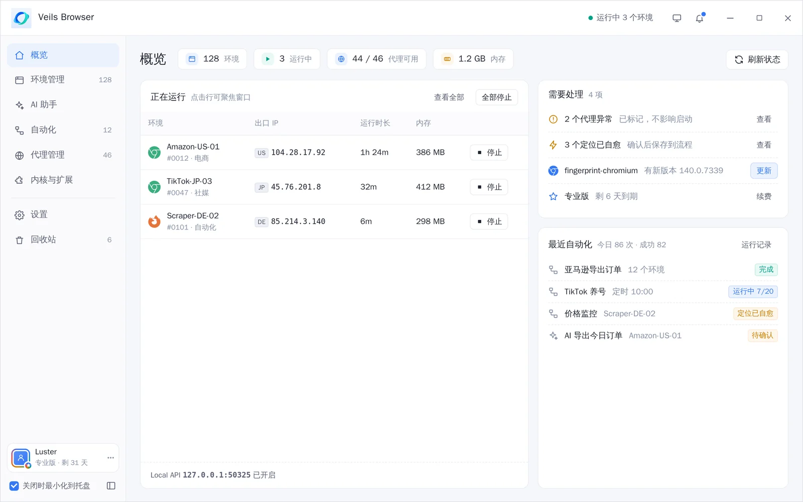
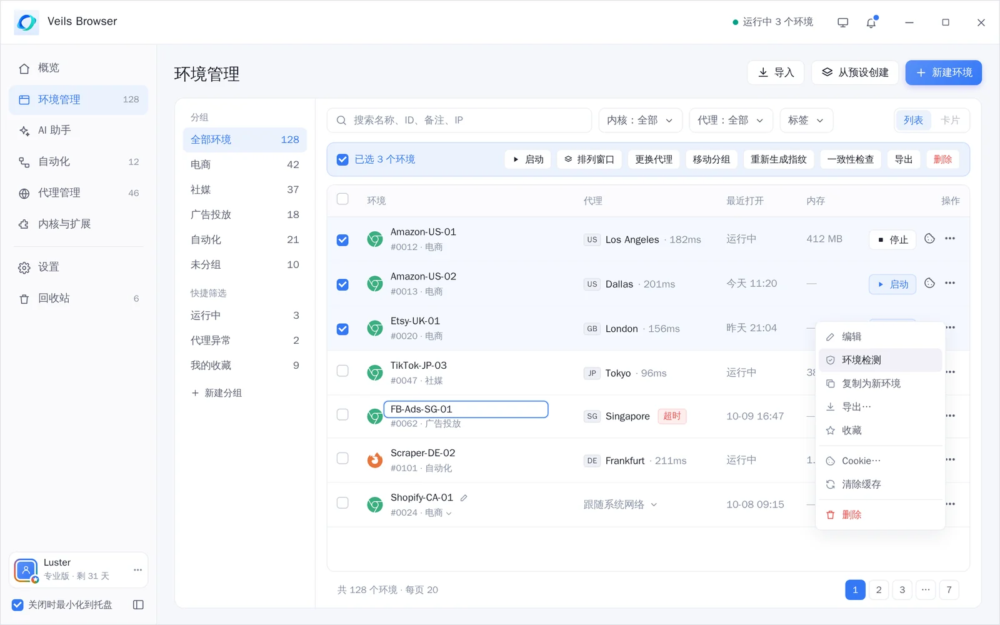
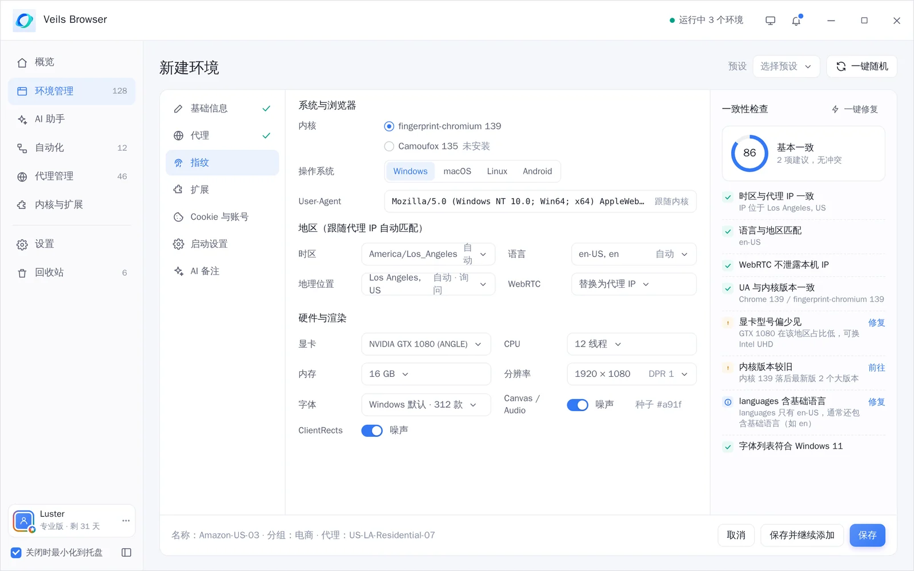
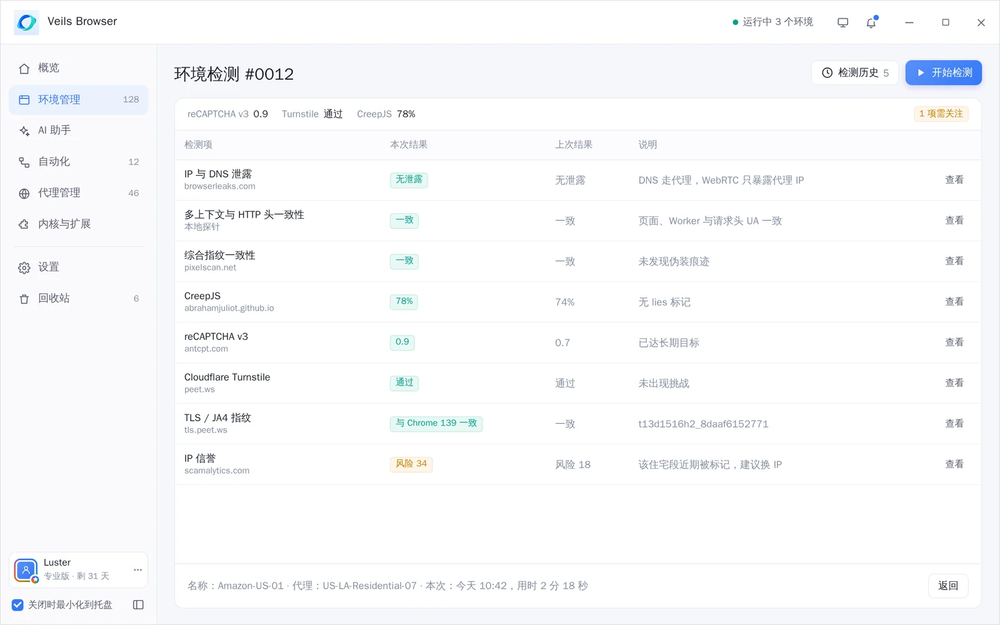
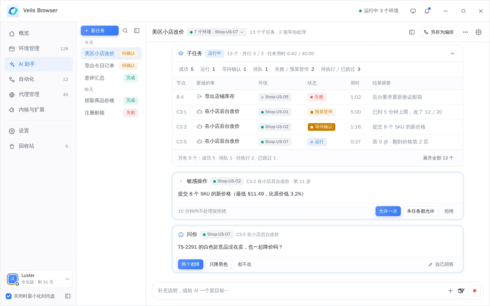
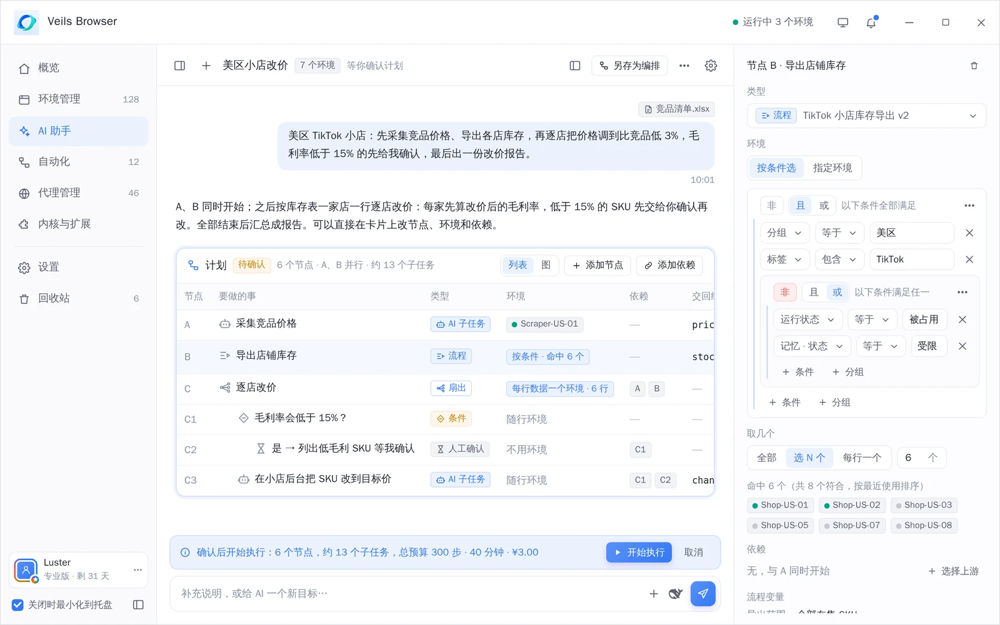
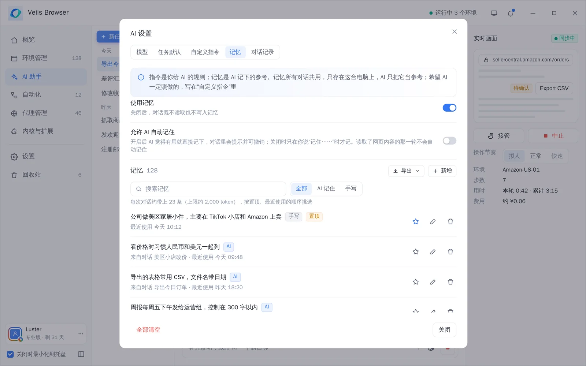
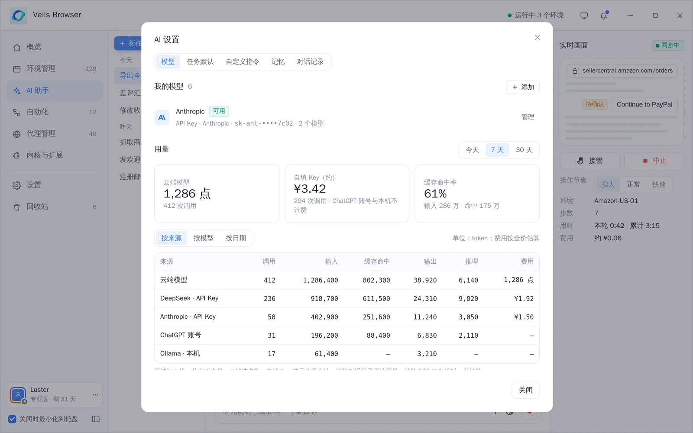
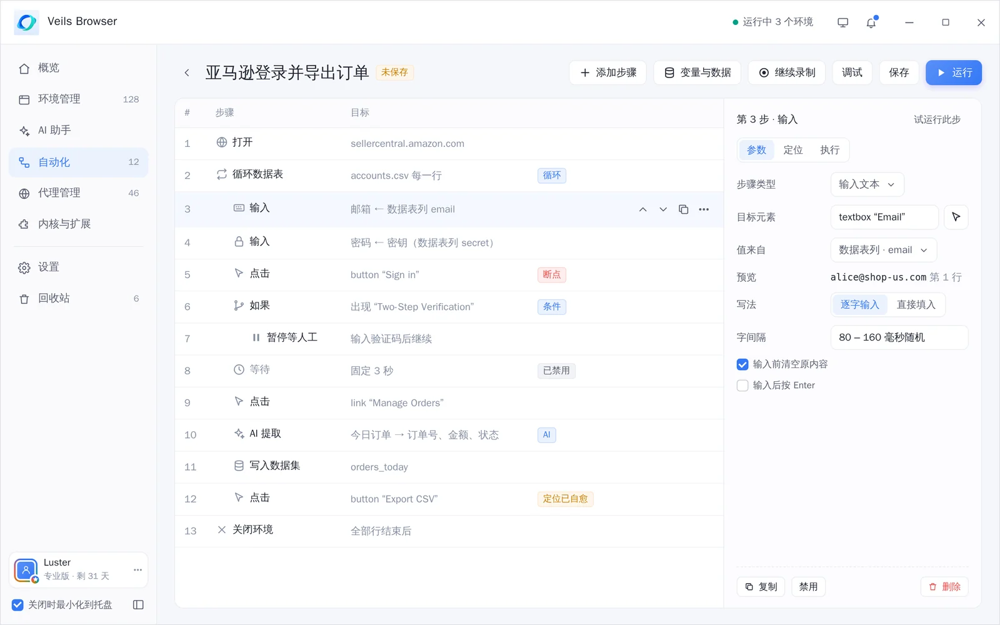
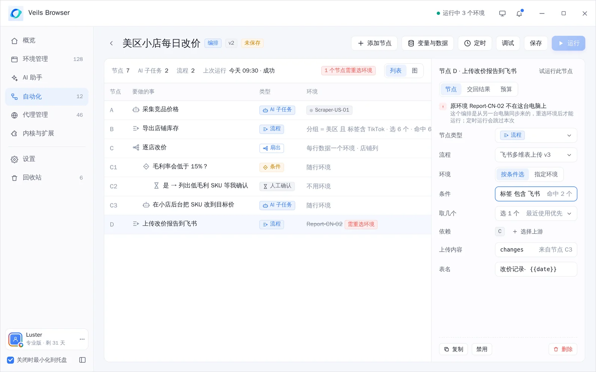

<div align="center">


# Veils

**每个账号一个独立环境，重复的网页操作交给 AI。**

独立的指纹、代理、Cookie 与扩展，环境之间互不关联，像在不同电脑上登录；<br>
一句话让 AI 助手在多个环境里并行办事，跑通的任务可存为自动化流程反复运行。

[](https://github.com/Enasdt/releases/releases/latest)
[](https://github.com/Enasdt/releases/releases)


[**下载最新版**](https://github.com/Enasdt/releases/releases/latest) · [更新日志](https://github.com/Enasdt/releases/releases) · [问题反馈](https://github.com/Enasdt/releases/issues)

<br>



</div>

> [!NOTE]
> Veils 目前处于**公开测试阶段**（0.0.x 版本），更新频繁。客户端内会提示新版本，确认后自动下载、校验并安装，环境数据不受影响。
>
> 界面截图来自设计稿，示例数据仅作演示，实际界面以最新版本为准。

---

## 简介

Veils 是一款由 AI 驱动的多环境指纹浏览器，适合需要在一台电脑上同时打理多个账号、多个店铺或多个测试身份的人，比如跨境电商、社媒运营、广告投放、数据采集和软件测试。

- **环境彼此隔离**：每个环境有自己的指纹、代理、Cookie、扩展和存储，环境之间不共享任何浏览数据。
- **一句话交给 AI**：描述目标，AI 先给出计划，再分派到多个环境并行执行并汇总结果；过程看得见，随时可以接管。
- **跑通就能复用**：AI 做过的任务可另存为自动化流程或编排，之后批量、定时运行，不再花模型费用。
- **数据留在本机**：环境、任务记录、记忆和截图默认保存在你的电脑上，敏感字段在本机加密。

| | |
|---|---|
| 🧩 **多环境管理** | 分组、标签、批量操作，几百个环境也能快速找到；运行状态与代理延迟一眼可见。 |
| 🛡️ **指纹隔离** | 按本机硬件生成贴近真实浏览器的指纹，时区、语言跟随代理出口；启动前检测泄露与一致性。 |
| 🤖 **AI 助手** | 对话即任务：打开网页、点击、填写、提取数据；复杂目标拆成计划，多个环境同时处理。 |
| 🔁 **自动化与编排** | 录一遍就成流程；多个流程和 AI 子任务可组成编排，按条件挑环境、并行运行、定时触发。 |
| 🧠 **记忆与指令** | AI 记住你的长期偏好，可设全局与环境指令；用量与费用按模型、来源一目了然。 |

---

## 多环境管理



- **环境**：分组、标签、快捷筛选、回收站与批量操作（启动、换代理、移动分组、重新生成指纹、一致性检查、导出等）；可从预设新建环境，环境可导出为导出包在另一台电脑导入。
- **指纹**：User-Agent、Canvas、WebGL、音频、字体、屏幕、硬件、时区与语言、WebRTC、媒体设备等均可可视化配置；自动生成的配置按本机硬件取值，表现更贴近真实浏览器；编辑时右侧实时给出一致性评分与修复建议。
- **多内核可选**：提供 Chromium 系与 Firefox 系内核，首次使用时下载并校验，安装包更轻；可设置 GitHub 加速地址，下载失败也能手动下载后导入。
- **代理**：支持常见协议、订阅与批量导入，可组成链式代理；启停环境、切换出口时不打断其他环境的连接。
- **Cookie 与扩展**：Cookie 可粘贴、逐条添加、按站点管理并导出；扩展从商店链接或本地文件添加一次，按环境或分组挂载。
- **AI 备注**：为环境记下平台、账号、用途与状态，AI 运行时参考；AI 运行后可提出更新建议，你确认后才写入。



- **环境检测**：一键检测 IP、DNS、WebRTC 泄露与指纹一致性，保留历史记录，可前后对比。



## AI 助手



- **对话即任务**：默认是普通对话；需要操作浏览器时，从输入框选一个或多个环境，没运行的环境会自动启动。右侧实时显示环境画面，并框出 AI 正在操作的元素。
- **先计划后执行**：复杂目标先给出执行计划（节点、类型、环境、依赖与预算），可以直接在卡片上修改，确认后多个环境并行处理，最后汇总成报告。
- **人在回路**：购买、支付、删除、填入密码等敏感操作先请你确认；打开没去过的网站、本机或内网地址前先询问，也可设置阻止的网站。遇到验证码、二次验证或需要你选择时会停下来问你，可随时接管浏览器，交还后接着做。
- **密码不外泄**：密码与 TOTP 只以密钥引用的形式使用，可绑定可用站点，明文不发给模型，也不写进日志。
- **思考强度可选**：为思考类模型选择强度，各家接口自动换算，不支持的级别自动降级。
- **长对话不断片**：较早的对话自动整理成摘要继续使用，摘要可查看和编辑，你说过的要求始终保留原话。
- **丰富的回复**：逐字流式输出、思考过程单独显示；图片、视频、文件直接显示，也可出现选项、表单、表格、图表等可操作控件。
- **模型自由选**：支持 OpenAI 兼容、Anthropic、Gemini、Ollama 等来源，可用自己的 API Key、本机模型或云端模型；“测试连接”会真实发起一次最小请求确认可用。



### 记忆、指令与用量

- **长期记忆**：AI 可记住你的长期参考信息（也可手动添加、置顶、编辑），敏感内容不会被记下；记忆只存在这台电脑上。
- **自定义指令**：全局指令对所有对话生效，环境指令只在操作对应环境时生效。
- **用量统计**：按来源、模型或日期查看调用次数、输入输出、缓存命中与费用。
- **随时清理**：可按时间清除对话记录，或一键清除全部 AI 数据。





## 自动化与编排



- **录制**：点击、输入、选择、上传、按键、滚动、切换标签页等操作都会被记下；结束后列出录到的邮箱、手机号、密码等，可一键改成变量或密钥。
- **编辑器**：步骤可拖动排序、多选批量操作，支持撤销重做、自动保存草稿与历史版本；支持分支、循环、重试、数据表、HTTP 请求与自定义 JS。
- **AI 步骤与自愈**：可插入 AI 提取、AI 判断、智能填写；页面改版找不到元素时，AI 按描述重新定位，或暂停等你点选，并可写回流程。
- **批量与定时**：一次选多个环境运行，数据表可一行对应一个环境；某个环境失败不影响其他环境。支持定时运行，也可以用 AI 生成流程。
- **调试与记录**：断点、单步、从某步开始；运行记录含每步日志与失败截图，可从失败步骤重跑，提取的数据可导出为 CSV / JSON。
- **编排**：把多个流程、AI 子任务、条件判断和人工确认组合起来，按分组、标签、运行状态、环境备注等条件挑选环境，并行执行、传递中间结果并汇总；AI 执行过的计划可直接另存为编排，手动或定时运行。



## 更多

- **本地 MCP 服务**：Claude Code、Codex 等外部 AI 客户端可通过 MCP 操作环境、运行自动化流程和编排。
- **Local API**：在本机通过 HTTP 接口启动、停止、查询和管理环境与分组，方便接入已有脚本。
- **数据与备份**：数据、环境、内核目录可自由更改并自动迁移；支持自动备份、立即备份、导出全部；可直接清除 AI 对话记录与管理记忆。
- **托盘面板**：集中显示需要你处理的 AI 任务、等待人工的自动化、运行中的环境和下次定时；有待处理事项时弹出系统通知。
- **本地优先**：环境数据、任务记录、记忆、截图都存在你的电脑上；代理密码、API Key 等敏感字段在本机加密保存。

---

## 下载与安装

前往 [**Releases**](https://github.com/Enasdt/releases/releases/latest) 下载最新版本：

| 系统 | 文件 | 说明 |
|---|---|---|
| Windows 10 22H2+ / 11（x64） | `Veils-Setup-<版本>-win-x64.exe` | 安装版（推荐），无需管理员权限 |
| | `Veils-<版本>-win-x64.zip` | 便携版，解压即用 |
| macOS 12+（Apple 芯片 / Intel） | `Veils-<版本>-macos-universal.dmg` | 打开后把 Veils 拖进“应用程序” |
| | `Veils-<版本>-macos-universal.zip` | 压缩包，解压后拖进“应用程序” |

**国内下载慢？** 在下载链接前加上加速前缀，例如：

```text
https://ghfast.top/https://github.com/Enasdt/releases/releases/download/v<版本>/<文件名>
```

加速节点由第三方提供，下载后建议用 `SHA256SUMS.txt` 核对文件。

**校验文件**：每个版本都附带 `SHA256SUMS.txt`。

```powershell
# Windows（PowerShell）
Get-FileHash .\Veils-Setup-<版本>-win-x64.exe -Algorithm SHA256
```

```bash
# macOS
shasum -a 256 Veils-<版本>-macos-universal.dmg
```

**首次启动**：浏览器内核与代理核心会在首次使用时自动下载并校验，之后打开环境即可秒开。国内网络可在 设置 › 数据与备份 › 内核下载来源 中填写 GitHub 加速地址；下载失败时点“手动安装”，按提示自行下载文件后导入，校验通过即可使用。

<details>
<summary>macOS 提示“无法验证开发者”怎么办？</summary>

打开“系统设置 → 隐私与安全性”，在页面下方点击“仍要打开”，之后即可正常启动。

</details>

<details>
<summary>杀毒软件提示风险怎么办？</summary>

请只从本仓库的 Releases 页面下载，并用 `SHA256SUMS.txt` 核对哈希值，一致即为官方原版文件。

</details>

---

## 问题反馈

- **客户端内**：设置 › 常规 › 问题反馈。可附上问题描述，诊断包会加密发送，成功后显示工单号。
- **GitHub**：在 [Issues](https://github.com/Enasdt/releases/issues) 提交，请写明系统版本、Veils 版本和复现步骤。

> 本仓库仅用于发布安装包与更新说明，不包含源代码。

## 合规使用

Veils 用于管理你合法拥有的账号、保护个人隐私、开展软件测试与提升工作效率。请遵守所在地法律法规以及你所使用平台的规则；严禁将本软件用于欺诈、盗号、刷单刷量、发送垃圾信息等违法违规活动。

## 第三方组件

Veils 使用以下第三方组件，许可证随客户端一并提供：Chromium 系与 Firefox 系浏览器内核、Mihomo / sing-box 代理核心（GPL-3.0）、Microsoft WebView2 Runtime。浏览器内核与代理核心在首次使用时下载，以独立进程运行，不属于本软件。

---

<div align="center">
<sub>© 2026 Veils · 保留所有权利</sub>
</div>

